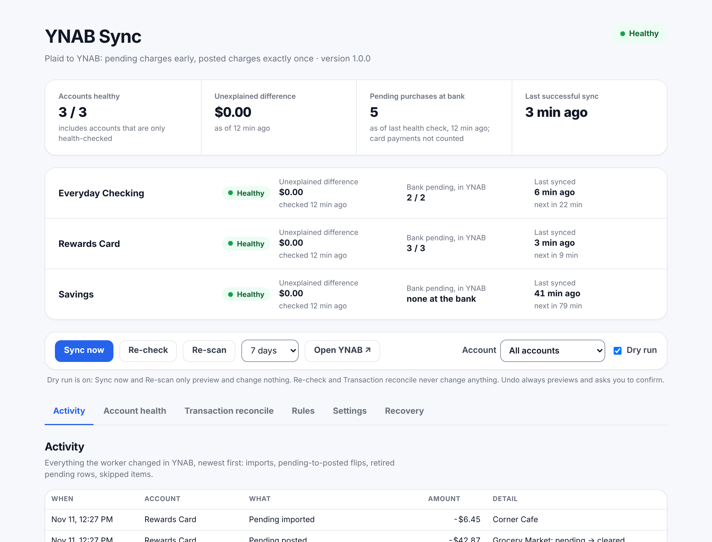

# YNAB Sync

Import your bank activity into [YNAB](https://www.ynab.com) through [Plaid](https://plaid.com), from a
free Cloudflare Worker you run yourself.

- **Pending charges show up right away** (uncleared), so YNAB's balance matches what you can actually spend.
- **When a charge posts, the same row flips to cleared.** No duplicate, no second row to approve.
- **Posted charges are imported exactly once**, whichever feed saw them first (this worker, YNAB's own
  Direct Import, or a row you typed in yourself).
- **Card payments and transfers between your own accounts** become real YNAB transfers.
- A **dashboard** shows each account's health (bank balance vs YNAB), what each sync did, and lets you
  undo a sync, pause everything, or run a dry run first.
- **Skip rules, payee aliases and transfer labels** for the cases banks get wrong.
- Runs on Cloudflare's free plan. Your bank tokens stay in your own Cloudflare account.

<picture>
  <source media="(prefers-color-scheme: dark)" srcset="docs/images/dashboard-dark.png">
  
</picture>

*The dashboard (demo data).*

> Not affiliated with YNAB or Plaid. You need your own Plaid account (Plaid decides whether you get
> access to real bank data) and your own YNAB subscription.

## How it works

Every 15 minutes (and right away when Plaid sends a webhook) the worker pulls new and changed
transactions for each linked account and writes them to YNAB with stable import ids. Each charge keeps
one identity from pending through posted, so the row it created is updated in place rather than
matched by guessing. Content matching (amount, payee, date, one-to-one) is only a fallback for rows
it didn't create. Every write runs under a single lock, so two syncs can never race.

More: [how a charge flows through it](docs/HOW-IT-WORKS.md) · [FAQ](docs/FAQ.md) ·
[known limitations](docs/LIMITATIONS.md) · [how the code is organized](docs/ARCHITECTURE.md) ·
[changelog](CHANGELOG.md)

## What you need

- [Node.js](https://nodejs.org) 22 or newer (matches the CI and current Wrangler toolchain)
- A [Cloudflare](https://dash.cloudflare.com/sign-up) account (the free plan is enough)
- A [Plaid](https://dashboard.plaid.com/signup) account with access to the **Transactions** product.
  Use `sandbox` to try it with Plaid's test banks; real banks need Plaid's production access.
- A YNAB account and a **personal access token** (YNAB → Account Settings → Developer Settings)

## Setup

**Step-by-step guide: [docs/setup](docs/setup/README.md)** (Plaid, YNAB, Cloudflare, the worker).
The short version:

1. **Get the code and log in to Cloudflare**
   ```bash
   git clone https://github.com/MikeAllen1/ynab-sync-plaid.git
   cd ynab-sync-plaid
   npm install
   npx wrangler login
   ```

2. **Create the storage and your config**
   ```bash
   npx wrangler kv namespace create SYNC_STATE
   cp wrangler.toml.example wrangler.toml
   ```
   In `wrangler.toml`, paste the KV `id` it printed, your **YNAB budget id** (the long id in your
   budget's web address: `https://app.ynab.com/<budget id>/budget`) and your time zone.

3. **Add your secrets** (stored encrypted by Cloudflare, never in the repo)
   ```bash
   npx wrangler secret put PLAID_CLIENT_ID
   npx wrangler secret put PLAID_SECRET
   npx wrangler secret put YNAB_TOKEN
   npx wrangler secret put ADMIN_TOKEN     # make up a long random password; the dashboard asks for it
   ```

4. **Deploy**
   ```bash
   npx wrangler deploy
   ```
   It prints your worker's address, e.g. `https://ynab-sync.<you>.workers.dev`.

5. **Plaid redirect** (needed for banks that send you to their own site to sign in): in the Plaid
   dashboard, add `https://ynab-sync.<you>.workers.dev/setup` to the **Allowed redirect URIs**.

6. **Link your banks.** Open `/setup` on your worker, enter your admin token, click **Link a new bank**,
   then pick which accounts to sync and the YNAB account each one feeds. New accounts start with
   sync **off**.

7. **Line up the starting point.** In YNAB, set each account's balance to the bank's **posted** balance
   (reconcile it). Then open `/dashboard`, go to **Settings** and turn the account's sync on. The first
   run picks up from there (currently-pending charges included).

8. **Webhooks** (optional, makes new charges appear within minutes instead of on the next cron):
   ```bash
   curl -H "x-admin-token: <your admin token>" https://ynab-sync.<you>.workers.dev/configure-webhooks
   ```
   Run it again after linking another bank.

Start with **Dry run** ticked on the dashboard to see what a sync would do before it writes anything.

## Security verification

Detailed transaction-level debug endpoints are disabled by default. This includes raw Plaid rows,
the YNAB register dump, pending-row traces, stuck-row detail, account-map diagnostics, and the other
`/debug/*` routes. Normal sync, account health, and transaction reconciliation remain available.
If you need the detailed recovery diagnostics temporarily, set
`ENABLE_SENSITIVE_DIAGNOSTICS = "true"` in your local `wrangler.toml`, deploy, and turn it back
off when finished. The account-map diagnostic never returns access-token previews or token-derived
fingerprints.

The dashboard uses a nonce-only script policy with no inline event handlers or style attributes.
The setup page uses nonce-authorized scripts; it retains `style-src-attr 'unsafe-inline'` only
because Plaid's published Link CSP requires that directive. See
[Plaid's Link CSP guidance](https://plaid.com/docs/link/web/).

### Verify a deployed Cloudflare Worker

Run the read-only verifier from a trusted local machine. It checks the deployed KV and Durable
Object bindings, the SQLite-backed SyncLock namespace, required secret *names* (never values),
production Plaid mode, an active Cloudflare API token, deployed versions, live CSP headers, and a
non-destructive runtime read/transaction probe.

Create a Cloudflare API token scoped to this account with only **Workers Scripts Read** and
**Workers KV Storage Read**. Do not grant Edit/Write permissions for this verification task.
The script does not print or retrieve secret values.

PowerShell:

```powershell
$env:CLOUDFLARE_API_TOKEN = "<read-only Cloudflare API token>"
$env:CLOUDFLARE_ACCOUNT_ID = "<Cloudflare account ID>"
$env:WORKER_URL = "https://<your-worker-host>"
$env:ADMIN_TOKEN = "<existing Worker ADMIN_TOKEN>"
npm run verify:production
```

The verifier is read-only. It does not deploy, modify secrets, change bindings, or write financial
records. The runtime readiness endpoint is admin-authenticated and only performs a temporary
Durable Object storage transaction plus a KV read. Cloudflare does not expose the historical
Durable Object migration ledger through the metadata endpoint used here; the verifier therefore
checks the deployed SQLite namespace, the active Worker binding, and actual runtime storage access.
Review the Worker migration configuration in `wrangler.toml` as part of release review.

For a local browser check of both pages and their CSP behavior, run `npm run test:browser`. CI
runs the same Chromium smoke test automatically.

## Configuration

| Where | What |
|---|---|
| `wrangler.toml` `[vars]` | `PLAID_ENV`, `YNAB_BUDGET_ID`, `TIMEZONE`, optional `CC_TRANSFER_CUTOFF` (card payments before this date stay in the card's starting balance), `PLAID_REFRESH = "off"` (no billed refresh calls on paid Plaid plans) and `WORKER_ORIGIN` (links in alert emails) |
| Secrets | `PLAID_CLIENT_ID`, `PLAID_SECRET`, `YNAB_TOKEN`, `ADMIN_TOKEN`; optional `RESEND_API_KEY` + `ALERT_EMAIL_TO` (email when a bank needs reconnecting or syncs fail), `ALERT_WEBHOOK_URL` |
| Dashboard → Settings | Per account: sync on/off, how often, catch-up window, health checks, how card payments name each card (last 4 / words) |
| Dashboard → Rules | **Skip rules** (bank items never to import), **payee aliases** (names that mean the same merchant), **transfer labels** (name transfers to your own accounts elsewhere by their last digits, e.g. `1234` → "Savings") |

## Everyday use

- **Dashboard** (`/dashboard`): overall status, each account's bank-vs-YNAB balance, recent activity,
  *Sync now*, *Undo…* (previews first), *Pause all syncing* / *Resume syncing*.
- **A bank says "Needs reauth"**: open `/setup` → **Reconnect**. Same accounts, same history.
- **Logs**: `npx wrangler tail`.
- **Turn it all off**: Pause on the dashboard, or remove the `[triggers]` block and redeploy.

## Costs and limits

- Cloudflare's free plan covers it: one cron every 15 minutes, a few KV reads and writes per sync.
- YNAB's API allows 200 requests an hour per token; the worker reads only a ~5-week window and caches
  account lists to stay well under that.
- Plaid: new US/Canada personal accounts get a free Trial plan (up to 10 bank logins). Paid plans bill
  Transactions per bank login per month, and refresh calls per call (set `PLAID_REFRESH = "off"` to skip those).
  Check your plan's terms before linking real banks.

## Security

- Bank access tokens are stored in your Cloudflare KV, never in the code or repo.
- Every endpoint that reads or changes data needs the admin token (`x-admin-token` header), compared
  in constant time. Plaid webhooks are verified with Plaid's signed JWTs.
- The dashboard and setup pages refuse to be framed.

## Contributing and security

Issues and pull requests are welcome; see [CONTRIBUTING.md](CONTRIBUTING.md). Please report security problems
privately (see [SECURITY.md](SECURITY.md)), never in a public issue.

## License

MIT. Use it, change it, share it. A mention back to this repo is appreciated.
