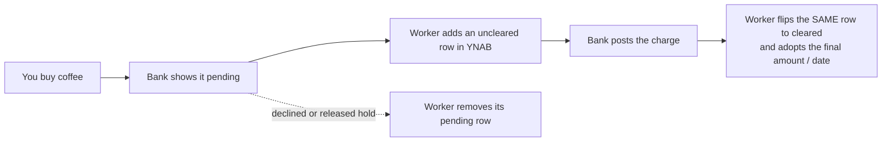
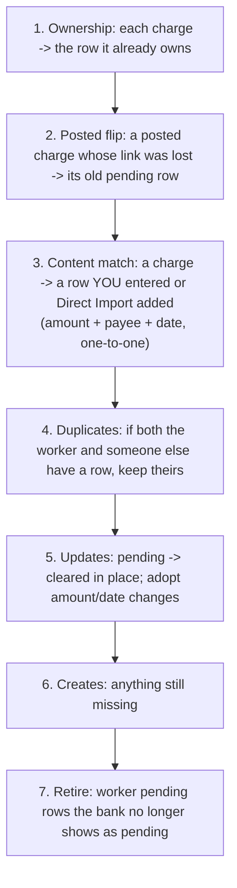
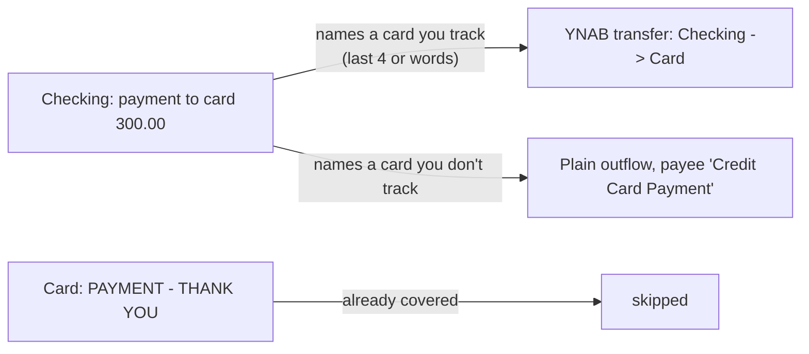

# How it works: the life of a charge

This page follows one purchase from the moment the bank sees it to the moment it's settled in YNAB. It's the
part that matters when you're wondering why a row looks the way it does.

## The short version

You approve and categorize the row in YNAB once, like any import. When it posts you don't get a second row.

## When the worker runs

- **Every 15 minutes** (the cron). Each account syncs on its own interval: 15 minutes to 4 hours, set on the
  dashboard.
- **Right away when Plaid says there's something new** (a webhook), if you've configured webhooks.
- **When you click Sync now** on the dashboard.

Only one sync writes at a time (a lock), so a webhook and the cron can never both add the same charge.

## One identity per charge

Plaid gives a pending charge one id, and the posted charge a different id that points back at the pending one.
The worker treats them as **one charge for its whole life** (its *lifecycle key*). The YNAB row it creates
carries an import id derived from that key, and the worker also remembers the link. So when the charge posts,
the worker already knows which row is its row. Nothing is found by guessing.

Every run plans everything first and writes nothing until the plan is complete:

Writes then happen in the order **create → update → delete**, so a failure part-way never leaves a charge with
no row at all.

### Why the row you typed in isn't duplicated

If you entered the coffee by hand before the bank saw it, step 3 finds your row (same amount, similar payee,
close date) and links it to the charge. The worker doesn't create its own. When the charge posts at the same
amount, it marks your row cleared; nothing else about your row changes. Matching is one-to-one: two $5.00
coffees on the same day are two charges and need two rows; one can't hide behind the other.

### Why a pending row disappears

A pending row is removed only when the bank stops showing that charge as pending **and** it didn't post (for
example a hotel or gas-pump hold that was released). Age alone never retires a row; the worker checks the bank's
last 30 days first.

## Card payments and transfers

- A payment from checking to a card you've linked becomes a **YNAB transfer** into that card, booked the
  moment the bank takes the money (uncleared while pending).
- The card's own "payment, thank you" line is then **skipped**, since the transfer already put the money on the
  card.
- How the worker knows which card: each card's **Payments name it by last 4 / words** setting, then the
  issuer's name if you have only one card from that issuer.
- **Money between your own accounts** (checking at one bank to savings at another, both linked) is booked once
  as a transfer, from the side the money leaves.
- **Money to accounts you haven't linked** (a savings account elsewhere, a brokerage, Zelle, Venmo) is a normal
  outflow with a **stable payee name** ("Savings", "Robinhood", "Zelle to Jane Doe"), so YNAB can remember a
  category. Name your own accounts by their last digits in **Rules → Transfer labels**.
- `CC_TRANSFER_CUTOFF`: card payments before this date are left alone, because they're already part of the
  card's starting balance.

## The health check (audit)

About once an hour (and when you click *Re-check*) the worker compares each account's **bank balance** to its
**YNAB balance** without changing anything. The dashboard shows the difference and, when it can, the reason: a
charge that posted today but isn't in the bank's balance yet, a row you marked cleared that's still pending at
the bank, a hold the bank's feed doesn't list. A difference that's explained isn't treated as a problem.

## Undo

Every sync records the rows it added. *Undo…* on the dashboard removes those rows, shows you exactly which first,
and asks before it does. It only removes added rows: it doesn't reverse anything else a sync did. A row it
marked posted stays posted, a pending row it removed stays removed (the charge comes back as its posted row),
and an amount or date it updated keeps the new value. Rows that have since posted or been reconciled are kept. If you delete a worker row in YNAB yourself, YNAB remembers the import id, and the worker
respects that: it won't re-add the same charge.

## Where the code for each part lives

See [ARCHITECTURE.md](ARCHITECTURE.md). The engine is `src/sync/engine.ts`; card and transfer rules are
`src/sync/transfers.ts`; name matching is `src/sync/matching.ts`.

## How you can tell the worker's rows apart

Every row the worker creates carries an import id that says it's the worker's, with one deliberate exception:

| Import id | Who made it |
|---|---|
| `wpend:...` (checking) or `pcc:...` (card) | the worker, from a pending charge |
| `pcp:...` | the worker, a posted card charge |
| `YNAB:<amount>:<date>:<n>` | Direct Import, **or** a posted checking charge the worker filled in |

The last one is on purpose: the worker uses Direct Import's own format so that, if Direct Import later sees the
same charge, it recognizes the row and doesn't book it a second time. The only record of which `YNAB:` ids are the
worker's is its list of posted-id pins (KV `posted:<plaid account>`). The debug views (`/debug/ynab-register`,
`/debug/ynab-history`) use that list and label those rows "worker (posted, Direct Import format)". If that list is
ever lost, the worker treats its own posted rows like Direct Import rows: still matched one to one, never
duplicated, but no longer offered by Undo.
