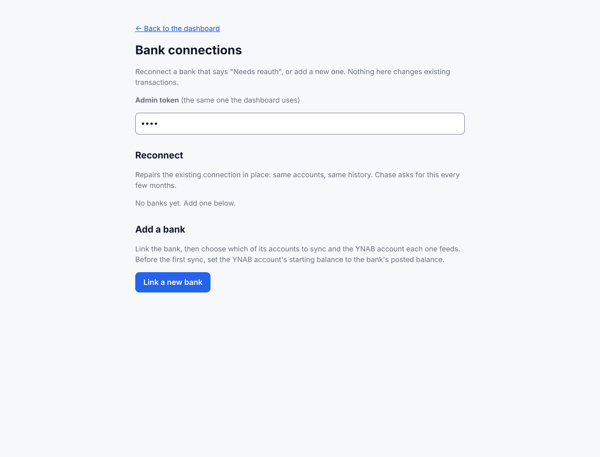
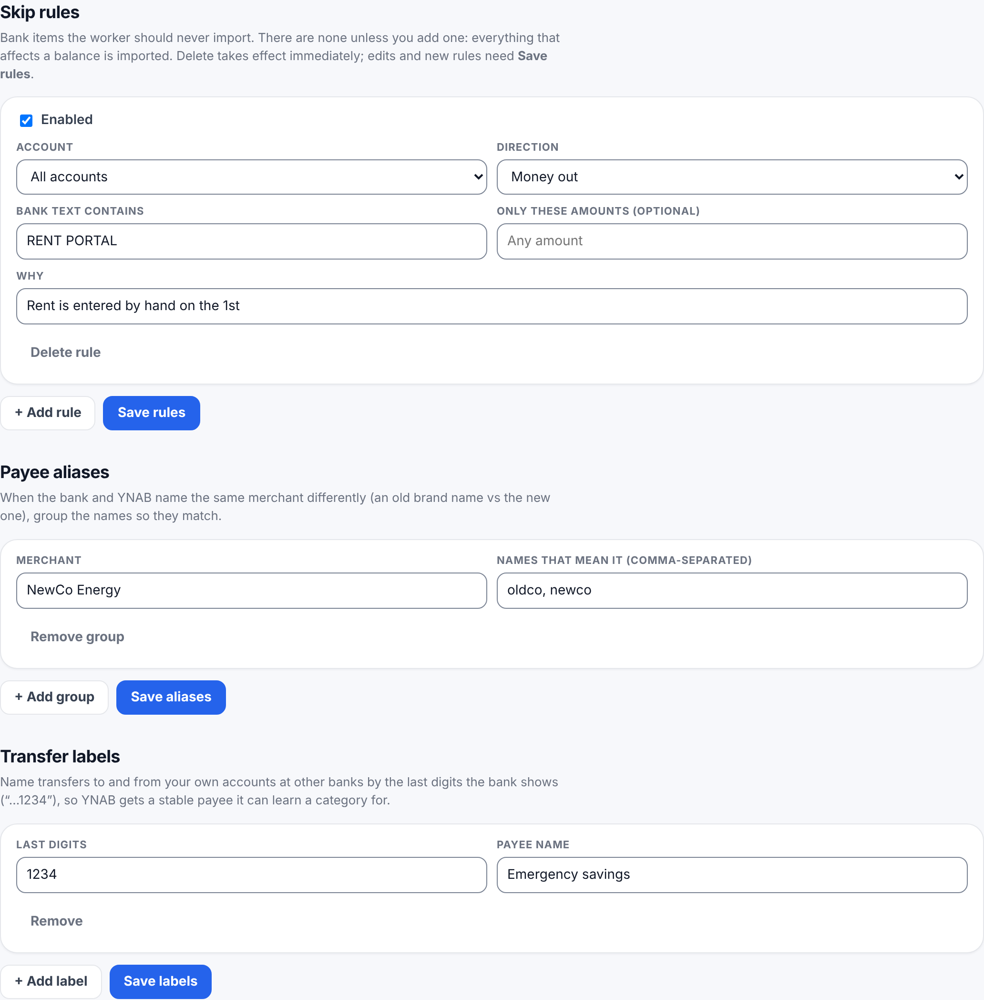

# 4. The worker

Run these from the `ynab-sync-plaid` folder.

## Configure

```bash
cp wrangler.toml.example wrangler.toml
```

Open `wrangler.toml` and fill in:

| Setting | Value |
|---|---|
| `id` under `[[kv_namespaces]]` | the KV id from [step 3](3-cloudflare.md#storage) |
| `YNAB_BUDGET_ID` | your budget id from [step 2](2-ynab.md#budget-id) |
| `TIMEZONE` | your time zone, e.g. `America/Chicago`, `Europe/London` ([list](https://en.wikipedia.org/wiki/List_of_tz_database_time_zones)) |
| `PLAID_ENV` | `production` for real banks, `sandbox` to test |

Optional:

| Setting | When |
|---|---|
| `CC_TRANSFER_CUTOFF` | Your start date (`YYYY-MM-DD`). Card payments before it stay inside the card's starting balance instead of becoming transfers. |
| `PLAID_REFRESH = "off"` | On a paid Plaid plan, where asking Plaid to re-check the bank is billed per call. |
| `WORKER_ORIGIN` | Your worker's address, so alert emails link to your dashboard. |

`wrangler.toml` is git-ignored, so your ids never end up in a commit.

## Secrets

Each command asks you to paste the value:

```bash
npx wrangler secret put PLAID_CLIENT_ID
npx wrangler secret put PLAID_SECRET
npx wrangler secret put YNAB_TOKEN
npx wrangler secret put ADMIN_TOKEN
```

`ADMIN_TOKEN` is a password you make up (long and random, e.g. from a password manager). Anyone with it can use
your dashboard, so don't reuse a real password.

Optional email when a bank needs reconnecting or syncing keeps failing, through [Resend](https://resend.com)
(free tier):

```bash
npx wrangler secret put RESEND_API_KEY
npx wrangler secret put ALERT_EMAIL_TO
```

## Deploy

```bash
npx wrangler deploy
```

It ends with your worker's address, e.g. `https://ynab-sync.jane.workers.dev`. Open
`https://ynab-sync.jane.workers.dev/dashboard`, paste your admin token, and you should see
"No accounts yet. Add a bank".

## Link your banks



1. Open `/setup` on your worker (or **Add a bank** on the dashboard) and enter your admin token.
2. Click **Link a new bank** and sign in to your bank in Plaid's window. Banks like Chase send you to their own
   site and back.
3. For each account the bank offers, pick the YNAB account it should feed (or leave it out) and add it.
   New accounts are added with **sync off**.
4. Repeat for each bank.

## Start syncing, one account at a time

1. **Line up the starting point.** In YNAB, reconcile the account so its cleared balance equals the bank's
   **posted** balance today (pending charges not included).

   Why it matters: the first sync never imports history. What it does depends on what YNAB already has:

   - **A new or hand-kept YNAB account** (nothing imported in the last 30 days): it imports what's pending now and
     posted charges from **tomorrow** on. Everything older is assumed to be in the starting balance.
   - **An account YNAB's Direct Import (or an earlier copy of this worker) already fills**: it catches up from a few
     days before YNAB's newest imported row, matching what's already there instead of duplicating it. Your
     balance should already be right; just make sure it's reconciled.

   If you skip this step, nothing breaks and nothing is duplicated, but the YNAB balance stays off by whatever
   the starting balance was missing, and the worker won't fix it for you (it only adds new activity). **Re-check**
   shows the difference; correct it with a reconciliation adjustment in YNAB for that amount. Don't use Re-scan
   for it: it only looks back 30 days and stops at the starting point.
2. On the dashboard: **Settings**, find the account, tick **Sync: the worker writes to this account**, choose
   how often (every 15 minutes to every 4 hours), and click **Save accounts**.
3. Leave **Dry run** ticked and click **Sync now**. The activity list shows what it *would* do: today's pending
   charges and anything posted since your starting point.
4. Happy with it? Untick **Dry run** and click **Sync now** again. The rows appear in YNAB, unapproved, for
   you to categorize as usual.

From then on it runs by itself.

## Faster updates (optional)

Plaid can tell the worker the moment a bank has something new (a webhook) instead of waiting for the next
check. On the dashboard, open **Recovery** and click **Re-register webhooks**. Or from a terminal:

```bash
curl -X POST -H "x-admin-token: <your admin token>" https://ynab-sync.jane.workers.dev/configure-webhooks
```

Banks linked from `/setup` are registered automatically; this is only needed for banks linked before that, or if the worker's address changed.

Scripts that call the worker's other actions work the same way: send `POST` with the `x-admin-token` header.

## Tune it for your banks (optional)

After a week or so, look at what came in and adjust on the dashboard:




- **Settings → each credit card → "Payments name it by last 4 / words"**: how your checking account's
  statement names a payment to that card (e.g. `1234`, or `sapphire`). That's what turns a card payment into a
  YNAB transfer.
- **Rules → Transfer labels**: name money moving to your own accounts at other banks by their last digits
  (`1234` → "Savings").
- **Rules → Payee aliases**: when the bank and YNAB call the same merchant different names.
- **Rules → Skip rules**: anything you always enter by hand and don't want imported.
